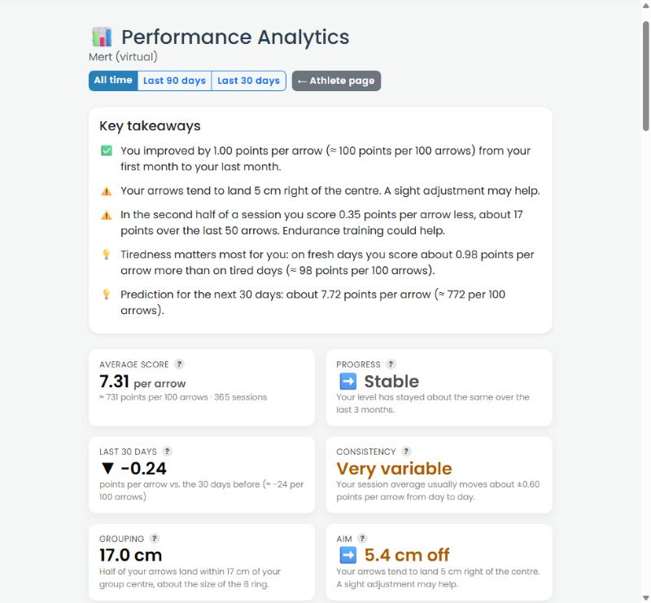
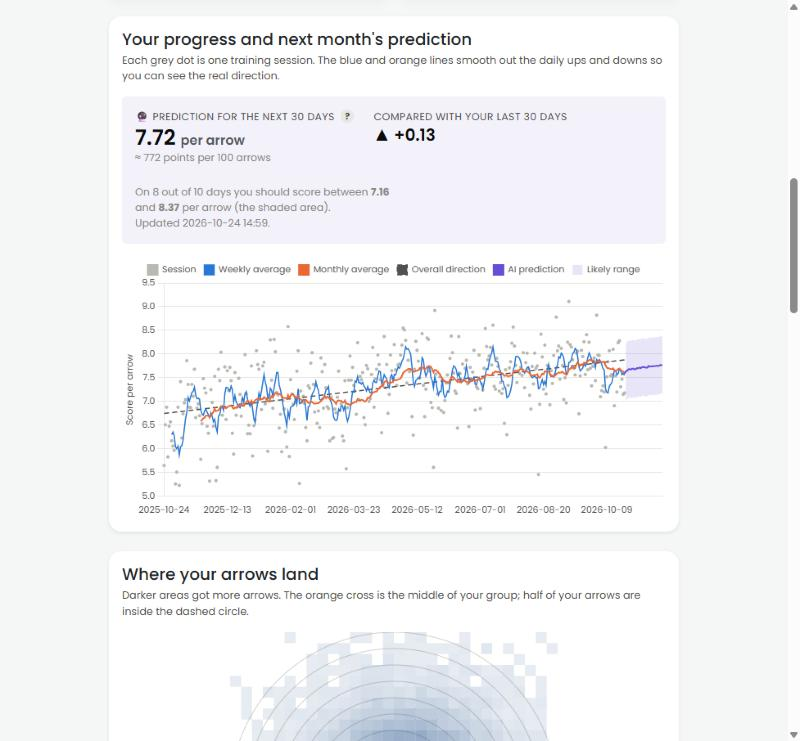
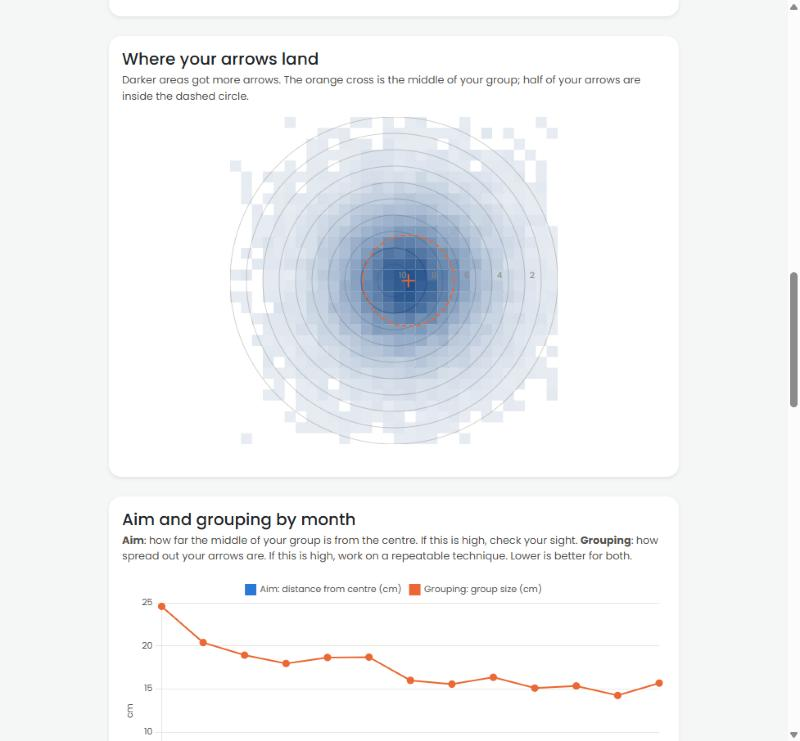
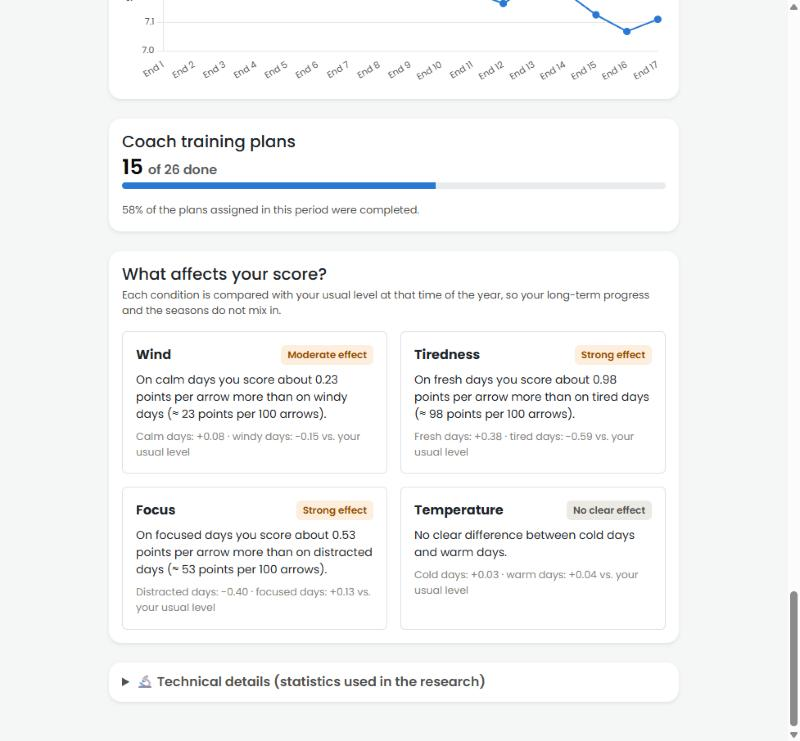
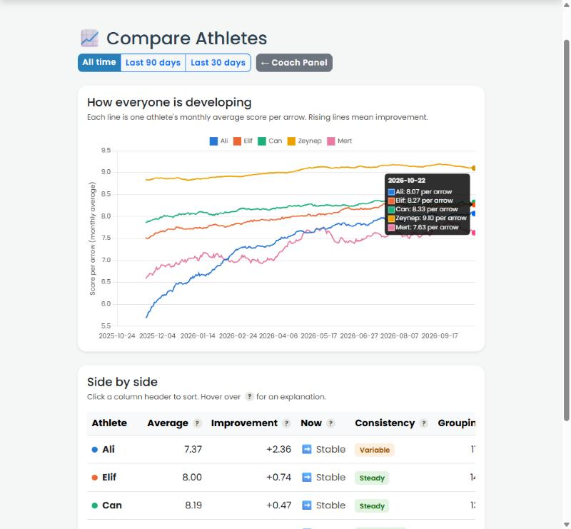
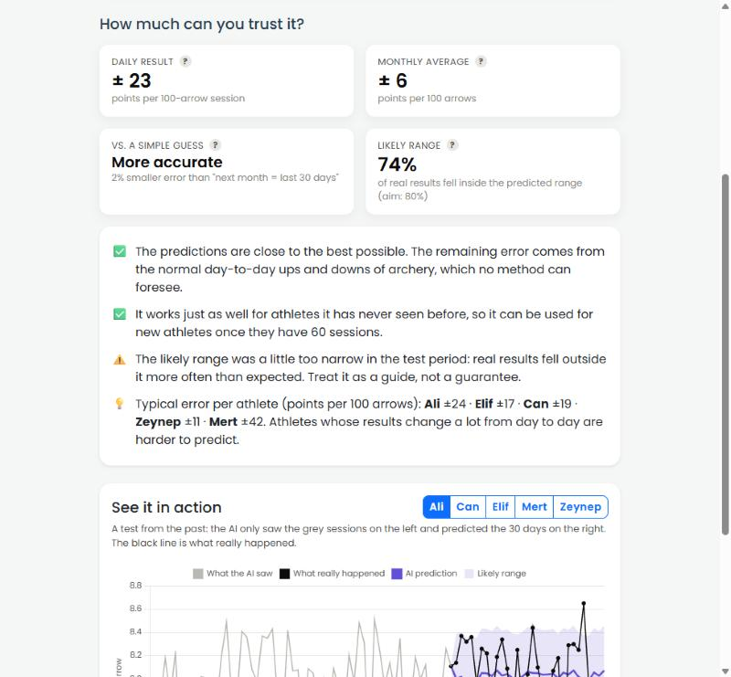
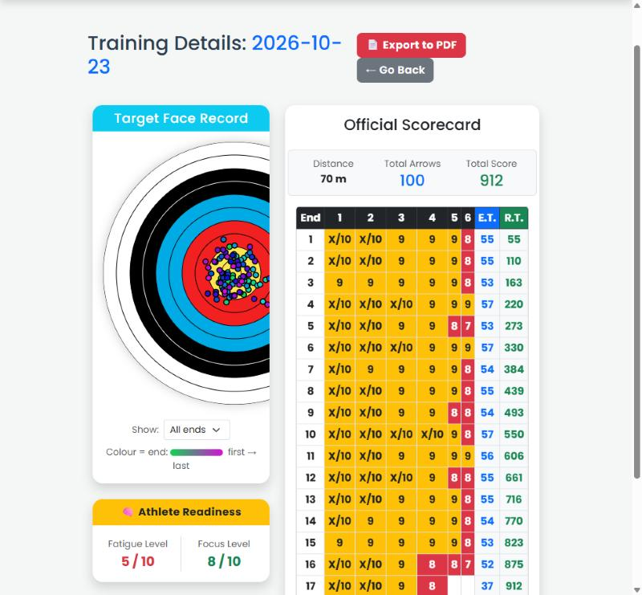

# 🎯 Archery Performance Tracker

A web application for archers and coaches that records training sessions arrow by arrow, turns them into easy-to-read statistics, and uses an LSTM neural network to predict each archer's performance over the next month.

This project was built as a bachelor's thesis. Because real long-term training data was not available, it ships with a **reproducible simulation of five virtual students** who each shoot 100 arrows a day at 70 m for a full year (182,500 arrows in total).



---

## Contents

- [Features](#features)
- [Screenshots](#screenshots)
- [Tech stack](#tech-stack)
- [Getting started](#getting-started)
- [Demo accounts](#demo-accounts)
- [Project structure](#project-structure)
- [How the data is simulated](#how-the-data-is-simulated)
- [How the prediction model works](#how-the-prediction-model-works)
- [Running the tests](#running-the-tests)
- [Limitations](#limitations)

---

## Features

**For archers**
- **Interactive scorecard:** click where each arrow landed on the target face; the score, end totals and running total are calculated automatically. Every arrow is stored with its position in millimetres from the centre.
- **Performance analytics** in plain language: key takeaways, progress, consistency, grouping, aim offset, which rings you hit, month-by-month results, tiredness within a session, and how wind, tiredness and focus affect your score.
- **30-day prediction:** an AI forecast of your next month with a likely range.
- **Equipment logs:** sight marks for each distance and bow tuning records (brace height, tiller, nocking point, draw weight).
- Bowstring lifespan tracker, achievement badges, weather capture, PDF scorecards and CSV export.

**For coaches**
- See every athlete's statistics, sessions, sight marks and bow setup.
- Assign training plans (conditioning, technique, mental) and track completion.
- **Compare athletes** side by side.
- **Predictions page:** how reliable the forecasts are, explained without jargon, and a button to retrain the model.

Every analytics page keeps the full statistics (standard deviations, regression, correlations, box plots, model error metrics) in a collapsed **Technical details** section for research use.

## Screenshots

| | |
|---|---|
|  |  |
| **Progress and 30-day prediction** | **Impact heatmap** |
|  |  |
| **What affects your score** | **Coach: compare athletes** |
|  |  |
| **Coach: prediction reliability** | **Scorecard of a 100-arrow session** |

## Tech stack

| Area | Tools |
|---|---|
| Web app | Python, Flask, Jinja2, Bootstrap 5 |
| Database | SQLite, SQLAlchemy, Flask-Migrate (Alembic) |
| Statistics | pandas, NumPy, SciPy |
| Machine learning | PyTorch (LSTM) |
| Charts | Chart.js, HTML canvas |
| Tests | pytest |

## Getting started

Tested with **Python 3.14** on Windows. The commands below are for Windows; on macOS or Linux use `source .venv/bin/activate` to activate the environment.

**1. Get the code and create a virtual environment**

```bash
git clone https://github.com/ByAurelius/archery-performance-tracker.git
cd archery-performance-tracker
python -m venv .venv
.venv\Scripts\activate
```

**2. Install the dependencies**

```bash
pip install -r requirements.txt
```

> PyTorch is about 200 MB. On Linux, `pip install torch --index-url https://download.pytorch.org/whl/cpu` installs the smaller CPU-only build first.

**3. Create the database**

```bash
flask --app app db upgrade
```

This creates an empty database in `instance/archery.db`. The database file is not stored in Git.

**4. Add the demo accounts and the simulated data**

```bash
python create_demo_users.py
python seed_synthetic_data.py
```

The second command generates one year of data for five virtual students in a few seconds. It always produces exactly the same data; add `--reset` to delete and regenerate the virtual students.

**5. Train the prediction model**

```bash
python train_forecast.py
```

Takes about a minute on a normal laptop. It trains and evaluates the LSTM, saves it to `models/`, and creates a 30-day prediction for every archer with at least 60 sessions.

**6. Start the app**

```bash
python app.py
```

Open http://127.0.0.1:5000 and log in with one of the demo accounts below.

## Demo accounts

Log in with the **email address**. These accounts exist only on your own computer and are meant for testing.

| Role | Email | Password | Profile |
|---|---|---|---|
| Coach | coach@demo.com | `Coach123!` | Sees all athletes |
| Athlete | ali@demo.com | `Student123!` | Fast-learning beginner |
| Athlete | elif@demo.com | `Student123!` | Steady intermediate |
| Athlete | can@demo.com | `Student123!` | Plateaus after about four months |
| Athlete | zeynep@demo.com | `Student123!` | Elite and very consistent |
| Athlete | mert@demo.com | `Student123!` | Inconsistent, tires quickly, pulls right |
| Athlete | athlete@demo.com | `Athlete123!` | Empty account for entering sessions by hand |

## Project structure

```
archery-performance-tracker/
├── app.py                   Flask app: database models, routes, forecast refresh
├── analytics.py             Statistics on an archer's sessions and arrows (pandas, SciPy)
├── insights.py              Turns the statistics into plain-language labels and takeaways
├── forecasting.py           LSTM model, baselines, evaluation and live forecasts (PyTorch)
├── seed_synthetic_data.py   Simulation of the five virtual students
├── train_forecast.py        Trains, evaluates and saves the model; refreshes all forecasts
├── tune_forecast.py         Model selection on the validation set
├── create_demo_users.py     Demo coach and athlete accounts
├── models/                  Trained model (lstm_forecast.pt) and evaluation results
├── migrations/              Database schema versions (Flask-Migrate)
├── templates/               HTML pages (Jinja2)
├── tests/                   Unit tests
└── docs/screenshots/        Images used in this README
```

## How the data is simulated

Each virtual student shoots 100 arrows at 70 m on a 122 cm target every day from 24 Oct 2025 to 23 Oct 2026. Every arrow is drawn as a point around the archer's aiming point, and its score is computed from its distance to the centre, exactly as for arrows entered in the app. The spread of the group depends on:

- **Learning curve:** the group tightens over the year, at a different speed for each student.
- **Daily form:** some days are simply better than others.
- **Tiredness and focus:** each session gets a 1–10 rating for both, which widens or tightens the group.
- **Weather:** a shared seasonal wind and temperature series. Crosswind pushes arrows sideways, gusts add spread, and temperature has no effect, which the analytics correctly report.
- **Fatigue within a session:** later arrows are slightly less precise.
- **Equipment changes:** new, heavier limbs open the group for about two weeks.

Each student also gets consistent bow tuning logs, sight marks that change with draw weight, and fortnightly coach training plans. A fixed random seed makes the dataset identical on every run. The full model is documented at the top of `seed_synthetic_data.py`.

## How the prediction model works

The model looks at an archer's last **60 sessions** (session average, score spread, group size, tiredness, focus and wind) and predicts the average score per arrow of each of the **next 30 sessions** in one step.

- One **LSTM** network (2 layers, 64 units) is shared by all archers. Each archer's data is standardised separately, and the model predicts the change from their last 30-session average, so beginners and elite archers can be learnt together.
- Data is split **chronologically**: training on the first ~8 months, validation on the next 2 and testing on the last 2, with no overlap between the predicted days.
- Settings were chosen on the validation set only (`tune_forecast.py`).
- The likely range combines the model's own uncertainty (Monte Carlo dropout) with the archer's day-to-day variation.

**Test results** (last two months, average error per arrow; lower is better):

| Model | MAE | RMSE | Error of the monthly average |
|---|---|---|---|
| **LSTM** | **0.225** | **0.319** | **0.059** |
| Same as the last 7 sessions | 0.238 | 0.333 | 0.096 |
| Same as the last 30 sessions | 0.229 | 0.323 | 0.061 |
| Linear trend of the last 90 sessions | 0.229 | 0.323 | 0.073 |
| *Oracle: the simulator's own expected value* | *0.227* | *0.319* | *0.051* |

MAE = Mean Absolute Error, RMSE = Root Mean Square Error. An MAE of 0.225 means a prediction is off by about ±23 points over a 100-arrow session. The LSTM matches the oracle, which is the best possible forecast in expectation, so almost all of the remaining error is day-to-day chance. It performs just as well on archers it was not trained on (leave-one-archer-out test).

## Running the tests

```bash
python -m pytest
```

The 25 unit tests cover the statistics, the plain-language labels and the forecasting pipeline, including checks that no future data leaks into the training windows.

## Limitations

- **Simulated data.** The model learns the patterns defined in the simulation. Real archers also have injuries, competitions, breaks and irregular training, so the results have to be confirmed with real data, which the app is ready to collect.
- **Prediction range.** In the test period 74 % of real sessions fell inside the 80 % likely range (81 % in validation), mainly because the model does not know about upcoming seasonal changes in the weather.
- **One club.** Every coach can see every athlete; there is no link between a coach and their own athletes yet.
- **Local development setup.** The secret key and debug mode are set in the code and anyone can register as a coach. These have to be changed before the app is put online.
